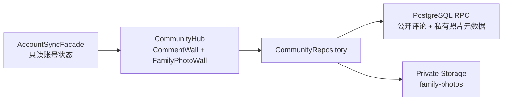

# Feature: 评论建议墙与私有亲子照片墙

**作者**: Codex
**日期**: 2026-10-10
**状态**: Approved

---

## 1. 背景 (Background)
### 1.1 问题描述
- 首页底部当前展示 AI 成长参谋，但用户希望将该区域转为更有社区参与感和家庭留存价值的双模块。
- 项目缺少用户之间公开交流意见的入口，产品建议只能停留在站外或临时沟通中，其他用户也无法看到已有反馈。
- 项目缺少安全的亲子照片私有空间；儿童照片可能包含人脸、位置和拍摄设备等敏感信息，不能使用公开 URL 或仅靠前端过滤实现隔离。
- 现有 Supabase Auth、PostgreSQL 和共享客户端可以作为统一身份与持久化边界，但当前尚未配置 Storage、评论数据表、照片元数据或相关 RLS 策略。
### 1.2 现状分析
- `src/components/Dashboard.vue` 仅在首页底部挂载一次 `AIExperience.vue`；替换该挂载点即可移除用户可见 AI 参谋，同时保留 `AISearch.vue`、`AIGrowthCoach.vue`、`src/ai/` 和 AI Edge Function 代码以便回滚。
- `src/main.js` 创建全应用唯一的 `clientProvider`，账号同步和 AI 客户端均复用该 Provider；社区模块应通过依赖注入复用同一 Supabase Client，不得在组件中重复创建客户端。
- `accountSyncFacade` 暴露只读 `accountState`，包含登录状态、用户 ID 和邮箱但不暴露 token；评论和照片组件可依据账号状态决定发布、删除、加载或清空私有数据。
- 现有数据库 migration 使用强制 RLS、最小授权和 pgTAP 跨用户测试；评论与照片应沿用相同安全基线。
- 当前 `supabase/config.toml` 未启用本地 Storage，项目也没有远端图片上传实现；照片处理、对象路径、私有签名 URL 和失败补偿需要新增。
- 项目已有 `useDialogFocus`、安全外链、统一错误提示和 Node 内置测试模式，可以复用于上传预览、弹窗和纯逻辑测试。
### 1.3 主要使用场景
- 未登录访客浏览所有用户公开发布的评论与产品建议。
- 登录用户填写公开昵称并发布不超过 300 字的留言，或删除自己发布的留言。
- 未登录用户点击留言或照片登录提示后打开现有账号中心，登录成功后返回原位置继续操作。
- 登录用户选择亲子照片、填写可选说明并上传；上传前在本机压缩尺寸、移除 EXIF/GPS 元数据。
- 登录用户浏览和删除仅属于自己账号的照片；退出登录或切换账号时立即清空页面中的照片和临时签名 URL。
- Supabase、网络或 Storage 暂不可用时，两个模块分别显示可恢复错误，不影响资源、工具、成长记录和账号本地数据。

## 2. 目标 (Goals)
- 用公开评论建议墙建立低门槛的用户反馈与社区可见性，同时用私有亲子照片墙提供严格账号隔离的家庭内容空间。
- 复用现有 Supabase 身份与客户端，确保公开留言不泄露邮箱，私有照片在数据库、对象存储和前端三个层面均按用户隔离。
- 保留原 AI 代码和服务端能力，仅替换首页挂载点，使回滚不需要恢复已删除代码或迁移数据。
### 2.1 非目标 (Non-Goals)
- 不公开亲子照片，不提供分享链接、公共相册或跨账号协作。
- 不实现留言点赞、回复、编辑、置顶、搜索、实时推送或管理员审核后台。
- 不实现照片编辑、滤镜、人物识别、AI 分析、评论或点赞。
- 不删除 AI 组件、客户端、数据库配额、Edge Function 或部署配置。
- 不提供无限历史分页；首版评论和照片均使用有上限的最近记录列表。

## 3. 需求细化 (Requirements)
### 3.1 功能性需求
- Dashboard 使用 `CommunityHub` 替换用户可见的 `AIExperience`，包含并列的评论建议墙和亲子照片墙，移动端改为单列。
- 评论列表允许匿名读取，按创建时间倒序展示昵称、内容和时间；单次加载最多 50 条，并提供手动刷新。
- 只有登录用户可以发布评论；昵称去除首尾空白后为 1～20 个字符，内容为 1～300 个 Unicode 字符。
- 评论不返回或展示邮箱；用户只能删除自己的评论，不支持编辑。
- 评论删除前需要二次确认，发布与删除成功后刷新列表并恢复明确焦点。
- 亲子照片墙未登录时只显示隐私说明和登录入口，不请求任何私有照片数据。
- 登录用户可以上传 JPEG、PNG、WebP；原始文件不超过 10 MiB，客户端将长边压缩至不超过 1920 像素并重新编码，输出不超过 5 MiB，以移除 EXIF/GPS。
- 每张照片可填写 0～80 个字符说明；对象路径必须位于当前用户 ID 目录下，数据库元数据的 `user_id` 必须等于 `auth.uid()`。
- 照片存储桶必须为 private；展示使用短时签名 URL，禁止使用公开 URL。Storage 上传必须存在当前用户的 pending 预留行，不能绕过 24 张上限直接堆积对象。
- 用户只能查询和删除自己的照片元数据与 Storage 对象；退出或切换账号时立即丢弃旧请求结果并清空照片列表。
- 上传采用“预留元数据 → 上传对象 → finalize”；上传失败时 cancel 预留，列表会自动恢复“对象已存在但未 finalize”的中断上传，并回收超过 1 小时且没有对象的预留。删除采用“先删私有对象 → 再删元数据”，元数据 RPC 在对象仍存在时拒绝删除，避免产生可反复绕过配额的孤儿对象。
- 评论与照片操作通过注入的 Community Repository 完成；Vue 组件不得读取 access token 或直接拼装底层请求。
- 登录 CTA 复用现有账号中心，并在账号中心关闭后恢复到触发按钮。
- AI 参谋相关代码全部保留，不再从 Dashboard 渲染。
### 3.2 非功能性需求
- **安全**：PostgreSQL 表启用并强制 RLS；评论写入和删除基于 `auth.uid()`；照片表和 Storage 对象在服务端按用户目录隔离，前端过滤不作为安全边界。
- **隐私**：公开评论 DTO 不包含邮箱和原始 user ID；照片签名 URL 仅短时有效；客户端重新编码图片以移除 EXIF/GPS。
- **输入限制**：评论、昵称、照片说明、MIME、扩展名、原始大小和处理后大小在客户端与服务端分别校验。
- **可靠性**：所有异步请求以账号 generation/owner ID 防止迟到写回；上传/删除均可由列表读取自动收敛中断状态；依赖失败不影响其他本地功能。
- **性能**：评论首屏最多 50 条；照片首屏最多 24 条；缩略展示使用客户端压缩后的对象，不上传未经处理的原图。
- **兼容性**：支持现有 Web 与 Tauri 2；图片处理使用浏览器 Canvas/CreateImageBitmap 能力，不引入第三方图片库。
- **可访问性**：发布表单、上传入口、错误、加载、空状态、删除确认和图片说明支持键盘及屏幕阅读器；390 × 844 无横向溢出。
- **升级回滚**：先部署 migration 与私有 bucket，再发布前端；回滚前端只恢复 AI 挂载，不删除评论、照片元数据或对象。
- **可观测性**：前端错误只记录稳定错误码和操作类型，不记录评论正文、照片内容、邮箱、签名 URL 或 token。

## 4. 设计方案 (Design)
### 4.1 方案概览
- 采用“Vue 双墙组件 → Community Repository → 共享 Supabase Client → PostgreSQL RPC / Private Storage”的单向结构。首页只替换 AI 的挂载点，原 AI 代码、注入和服务端能力均保留。
- 评论表不向浏览器开放直接查询权限；匿名与登录用户通过 RPC 获取不含 `user_id`/邮箱的公开 DTO，登录用户通过 RPC 创建和删除自己的留言。
- 照片元数据表与 Storage Bucket 均为私有。照片处理后上传到 `<auth.uid()>/<uuid>.webp`，数据库和 `storage.objects` Policy 分别校验当前用户，展示时只生成短时签名 URL。
- 首版不引入 Realtime。评论通过初始加载、手动刷新和写操作后刷新保持新鲜；照片只在当前账号登录后加载，减少订阅生命周期与跨账号泄漏风险。
- 图片对象和数据库元数据无法处于同一事务：上传前先通过 RPC 原子预留本人元数据槽位，Storage INSERT Policy 只允许已预留的 UUID WebP 路径；对象成功后 finalize，失败则 cancel。读取列表时自动将已有对象的 pending 记录转为 ready，并回收超过 1 小时且无对象的 pending。删除必须先移除 Storage 对象，再由 RPC 确认对象不存在后删除元数据；读取列表也会清理对象已不存在的 ready 元数据。



依赖方向：`Dashboard → CommunityHub → 子组件 → CommunityRepository → clientProvider`。账号中心通过 `CommunityHub → Dashboard → App` 事件上抛打开，社区组件不依赖 `AccountCenter` 实现。
### 4.2 组件设计 (Component Design)
#### 4.2.1 核心类/模块设计
- `CommunityHub.vue`：双模块布局、账号状态适配和登录事件上抛；不直接调用 Supabase。
- `CommentWall.vue`：公开评论列表、昵称与内容表单、刷新、本人删除及可访问状态。
- `FamilyPhotoWall.vue`：私有照片列表、上传预览、说明、删除和账号变化清理。
- `communityRepository.js`：唯一 Supabase 应用层适配器，隐藏 RPC、Storage、签名 URL、错误码和补偿逻辑；通过 `COMMUNITY_REPOSITORY_KEY` 注入。
- `photoProcessor.js`：纯前端图片类型/大小校验、尺寸计算、Canvas 重新编码和输出约束，不访问 Supabase。
- `main.js`：组合根，复用现有 `clientProvider` 创建 Community Repository。
- `Dashboard.vue`：将 `AIExperience` 挂载替换为 `CommunityHub` 并透传 `account-request`；不删除任何 AI 文件。
- `App.vue`：承接 `account-request` 并调用现有 `openAccountCenter(trigger)`。
- `202610100003_community_walls.sql`：评论、照片元数据、RPC、RLS、私有 bucket 和 Storage Policy 的最终权限边界。
#### 4.2.2 接口设计
前端 Repository 接口：

```text
CommunityRepository.isAvailable: boolean
listComments({ limit? }) -> Promise<CommentDTO[]>
createComment({ nickname, content }) -> Promise<CommentDTO>
deleteComment(commentId) -> Promise<boolean>
listOwnPhotos({ limit? }) -> Promise<PhotoDTO[]>
uploadOwnPhoto({ file, caption, width, height }) -> Promise<PhotoDTO>
deleteOwnPhoto(photoId) -> Promise<boolean>
```

`CommentDTO` 仅包含 `{ id, nickname, content, createdAt, canDelete }`。`PhotoDTO` 仅包含 `{ id, caption, mimeType, width, height, byteSize, createdAt, signedUrl }`；不暴露其他账号数据、token 或永久公开 URL。

| 错误码 | 说明 | 是否可重试 |
|---|---|---|
| `COMMUNITY_NOT_CONFIGURED` | Supabase 未配置 | 否 |
| `COMMUNITY_UNAUTHORIZED` | 未登录或会话失效 | 登录后重试 |
| `COMMUNITY_INVALID_INPUT` | 文本、文件或 DTO 非法 | 否 |
| `COMMUNITY_LIMIT_EXCEEDED` | 评论/照片数量或大小超过限制 | 否 |
| `COMMUNITY_NETWORK_ERROR` | 网络或依赖临时失败 | 是 |
| `COMMUNITY_STORAGE_ERROR` | 上传、签名或删除对象失败 | 是 |
| `COMMUNITY_NOT_FOUND` | 目标不存在或不属于当前用户 | 否 |

组件事件：`CommunityHub` 发出 `account-request(triggerElement)`；Dashboard 原样上抛；App 复用现有账号中心打开逻辑。
#### 4.2.3 数据模型
`public.community_comments`：

| 字段 | 类型 | 约束 |
|---|---|---|
| `id` | uuid | PK，默认 `gen_random_uuid()` |
| `user_id` | uuid | NOT NULL，默认 `auth.uid()`，引用 `auth.users` |
| `nickname` | text | trim 后 1～20 字符 |
| `content` | text | trim 后 1～300 字符 |
| `created_at` | timestamptz | NOT NULL，默认 `now()` |

索引：`created_at DESC, id DESC` 支持最近 50 条；`user_id, created_at DESC` 支持本人删除与审计。表不向 anon/authenticated 授予直接 SELECT，公开列表由安全函数隐藏 `user_id`。

`public.family_photo_items`：

| 字段 | 类型 | 约束 |
|---|---|---|
| `id` | uuid | PK，默认 `gen_random_uuid()` |
| `user_id` | uuid | NOT NULL，默认 `auth.uid()`，引用 `auth.users` |
| `status` | text | `pending` / `ready`，上传恢复状态机 |
| `object_path` | text | UNIQUE，必须以 `<user_id>/` 开头 |
| `caption` | text | 0～80 字符 |
| `mime_type` | text | 仅 `image/webp`（处理后统一格式） |
| `width` / `height` | integer | 1～1920 |
| `byte_size` | bigint | 1～5 MiB |
| `created_at` | timestamptz | NOT NULL，默认 `now()` |

索引：`user_id, created_at DESC, id DESC`。每用户最多 24 条，由创建 RPC 在按用户 advisory transaction lock 内检查。

Storage Bucket：`family-photos`，`public=false`、单文件 5 MiB、仅 `image/webp`。`storage.objects` 的 SELECT/DELETE Policy 检查 bucket、owner_id 与用户目录；INSERT 还必须匹配本人 pending 预留元数据和完整 UUID WebP 路径；不授予 UPDATE/upsert。
#### 4.2.4 并发模型
- 浏览器保持单线程事件循环；评论发布、评论删除和照片上传分别单飞，刷新可被新 generation 取代。
- 评论列表和照片列表使用 request generation；只有发起时的账号 owner ID 仍等于当前账号时才写回。退出或切换账号立即递增 generation、清空照片并撤销本地预览 URL。
- 评论创建/删除由 PostgreSQL 单语句或短 RPC 完成。照片元数据创建使用按 `auth.uid()` 的 transaction advisory lock，原子检查 24 张上限并插入，不在数据库事务中包含 Storage 网络调用。
- 每次上传使用随机 UUID 新路径且 `upsert=false`，避免并发覆盖和 CDN 旧内容。
- 评论公开列表允许最终一致；照片元数据与对象采用可恢复状态机实现最终一致，失败状态不得伪装成功。
#### 4.2.5 错误处理
- 未登录发布、上传或删除直接返回 `COMMUNITY_UNAUTHORIZED`，UI 引导打开账号中心。
- 4xx 输入、权限、数量上限为不可重试业务错误；网络、5xx、Storage 临时失败显示重试入口，不自动重放写操作。
- 图片处理失败时不发起网络请求；Storage 上传失败时取消 pending 预留；上传结果不确定或 finalize 中断时由列表读取恢复，无法确认对象存在时保留可重试状态。
- Storage 删除失败时保留元数据并允许重试；Storage 删除成功但元数据 RPC 中断时，下一次列表读取自动清理缺失对象的 ready 元数据。
- 签名 URL 批量生成失败时不展示无效图片，保留刷新入口；任一账号切换后旧签名结果均丢弃。
- 评论文本和昵称只以 Vue 文本插值渲染，禁止 `v-html`；服务端 trim、长度检查与权限校验不可由前端替代。
### 4.3 核心逻辑实现
1. 应用启动时在组合根创建 Community Repository，与账号同步和 AI 共用 `clientProvider`。
2. `CommentWall` 挂载后匿名调用 `list_community_comments(50)`；RPC 返回公开 DTO 和基于当前 JWT 计算的 `can_delete`。
3. 登录用户发布时，前端先做 Unicode 长度校验，RPC 再 trim 并校验；成功后将返回项置顶并清空表单。删除使用 owner-only RPC 并在确认后执行。
4. `FamilyPhotoWall` watch 当前 `userId`：无用户时立即清空；有用户时读取最多 24 条元数据，并批量生成 1 小时签名 URL。
5. 选择图片后，`photoProcessor` 校验原始 MIME/10 MiB，解码后按最长边 1920 等比缩放，Canvas 输出 WebP 并校验 5 MiB；重新编码自然移除 EXIF/GPS。
6. 上传先调用 reserve RPC 原子占用配额，再使用 `<userId>/<uuid>.webp` 且 `upsert=false` 上传；对象成功后调用 finalize，失败则 cancel。Storage Policy 只允许 pending 预留路径通过；列表读取会恢复已上传未 finalize 的记录并回收陈旧空预留。
7. 删除先使用当前本人元数据中的 `object_path` 调用 Storage API，再调用 RPC；RPC 只有确认对象不存在时才删除元数据，最后撤销页面 URL。
8. 评论墙错误与照片墙错误相互隔离；任一社区依赖故障不影响 Dashboard 其他工具或本地数据。

性能约束：评论/照片列表均使用有界查询；客户端在上传前压缩，避免传输原图；签名 URL 批量生成；不使用 Realtime、无限滚动或运行时图片分析。
### 4.4 方案优劣分析
优点：

- 数据隔离由数据库与 Storage 双重服务端策略保证，前端只负责体验层过滤。
- 复用现有 Supabase Client/Auth，新增基础设施最少，AI 能力仍可独立恢复。
- 客户端重编码同时降低带宽和 EXIF/GPS 泄漏风险。
- 评论 RPC 不暴露 user ID 或邮箱，公开性和隐私边界明确。

局限：

- 首版没有内容审核后台，公开评论仍可能出现不适当内容；可通过关闭创建 RPC grant 快速止写。
- Storage 与业务表无法强事务，因此删除失败可能暂时保留元数据，上传中断可能暂时保留 pending；列表读取和 1 小时 TTL 会自动收敛这两类状态。
- 客户端 Canvas 压缩占用瞬时 CPU/内存，超大图片在低端设备上可能失败，已通过原图 10 MiB 和最长边限制控制。
- 不启用 Realtime，其他用户的新评论需要手动刷新后可见。

## 5. 备选方案 (Alternatives Considered)
- **照片存入业务快照并随账号同步**：Base64 会迅速超过现有 2 MiB 快照边界，放弃。
- **公开 Storage Bucket + 难猜 URL**：URL 一旦泄露即可长期访问儿童照片，不满足用户隔离，放弃。
- **只靠前端按 userId 过滤**：请求者仍可绕过 UI 查询其他账号数据，必须使用 RLS/Policy，放弃。
- **评论表直接公开 SELECT**：会暴露内部 `user_id`；采用 RPC 公开专用 DTO。
- **使用 Realtime 评论订阅**：体验更新更快，但增加 publication、订阅清理和故障面；首版采用手动刷新。
- **上传原图并依赖服务端图片变换**：可能保留 EXIF/GPS，且图片变换能力受套餐影响；采用客户端重新编码。
- **新增独立后端或 Edge Function**：可以实现更强事务与审核，但超出首版复杂度；优先复用 PostgreSQL RPC 和 Storage Policy。

## 6. 业界调研 (Industry Research)

> **注意**：本章节应在完成自主设计后填写，用于验证方案、确保下限，而非作为设计的起点。

### 6.1 业界方案
- Supabase Storage 以 `storage.objects` RLS Policy 控制上传、读取和删除，官方示例支持以 JWT subject 作为路径首段进行用户目录隔离。
- Supabase 建议小于 6 MiB 的文件使用标准上传；本项目处理后限制 5 MiB，避免引入 TUS 断点续传复杂度。
- 私有文件通过带过期时间的 signed URL 展示；本项目使用 1 小时有效期并在账号切换时丢弃旧结果。
- Storage Bucket 支持按桶限制文件大小与 MIME 类型；应用层与 Bucket 双重限制降低绕过风险。
- PostgreSQL RLS 与 Supabase Auth JWT 结合提供多租户行隔离；公开评论额外通过 RPC 隐藏身份字段。
### 6.2 对比分析
- 与官方 Storage 模式一致，使用 private bucket、用户目录、owner/path Policy 和短时签名 URL，不使用 `getPublicUrl`。
- 与常规原图上传不同，本项目在浏览器端重新编码以去除 EXIF/GPS，并把处理后文件限制在标准上传推荐范围内。
- 不直接修改 `storage.objects` 元数据；上传和删除均通过 Storage API，避免对象与底层存储不一致。
- 跨 Storage/业务表没有原子事务，因此采用 pending/ready 状态、对象存在性校验、1 小时 TTL 和幂等随机路径，把中断恢复收敛在服务端契约内。

## 7. 测试计划 (Test Plan)
### 7.1 单元测试
- `photoProcessor`：MIME、原始 10 MiB、缩放比例、输出 5 MiB、Canvas/toBlob 失败和对象 URL 清理。
- `CommunityRepository`：公开评论 DTO、输入边界、未登录、本人删除、照片 owner 变化、上传补偿、签名失败和稳定错误映射。
### 7.2 集成测试
- pgTAP：游客只能读公开评论 DTO；登录用户发布和删除本人评论；跨用户删除失败；评论 DTO 不含 userId/email。
- pgTAP：照片元数据只能本人 CRUD；每用户 24 张上限；Storage Bucket 为 private；跨用户对象 SELECT/INSERT/DELETE 均失败。
- 浏览器：匿名评论、登录 CTA、发布/删除、照片选择/预览/上传/删除、退出清空、账号切换迟到响应、桌面和 390px 布局、焦点与 Escape。
### 7.3 性能测试（如适用）
- 验证 10 MiB 上限图片处理后最长边不超过 1920、输出不超过 5 MiB，上传前后 UI 保持可响应。
- 评论 50 条、照片 24 张时无横向溢出；签名 URL 使用批量请求而非 N 次串行调用。

## 8. 可观测性 & 运维 (Observability & Operations)

### 8.1 可观测性
- **日志**：前端诊断只记录 `operation`、稳定 `errorCode`、耗时和 actorType，不记录评论正文、昵称、照片、objectPath、签名 URL、邮箱或 token。
- **指标**：首版不新增远端埋点；通过 Supabase Dashboard 观察数据库请求、Storage 使用量和错误。
- **告警**：建议关注 Storage 使用量、5xx/4xx 突增和数据库函数失败；首版不新增自动告警基础设施。

### 8.2 配置参数 (Configuration)
| 参数名 | 类型 | 默认值 | 说明 | 是否支持动态修改 |
|--------|------|--------|------|------------------|
| `VITE_COMMUNITY_ENABLED` | bool | true | 是否启用双墙模块；关闭时显示不可用状态 | 否（重新构建） |
| 评论加载上限 | int | 50 | Repository 固定上限 | 否 |
| 照片加载/账号上限 | int | 24 | RPC 和 Repository 双重限制 | 否 |
| 签名 URL 有效期 | int | 3600 秒 | 私有照片临时访问 | 否 |

### 8.3 运维接口 (Operations Interfaces)
- Supabase migration 管理表、RPC、bucket 与 Storage Policy；不新增独立后台或管理 API。
- 只读 SQL 可按日期统计评论和照片数量；不得查询或导出儿童照片内容作为日志。
- 紧急停止公开留言写入时撤销 authenticated 对创建 RPC 的 execute grant，匿名读取仍可保留。

### 8.4 运维注意事项 (Operations Considerations)
- **发布顺序**：应用 migration 和 Storage 配置 → pgTAP/RLS 验证 → 前端构建与发布 → 生产匿名/双账号冒烟。
- **回滚**：前端恢复 `AIExperience` 挂载；保留表、函数、bucket 和对象，不执行 destructive rollback。
- **资源影响**：评论为小文本；主要成本是私有图片存储与流量。上传前压缩、24 张上限和 5 MiB bucket 限制控制资源。
- **故障处理**：数据库失败时评论与照片分别降级；Storage 失败不影响评论；常规中断由列表读取与 TTL 自动恢复，管理员绕过应用直接操作数据造成的不一致再通过 owner/path 只读核对脚本人工处理。

## 9. Changelog
| 日期 | 变更内容 | 作者 |
|------|----------|------|
| 2026-10-10 | 完成需求、架构、组件、数据、安全、并发、测试与运维设计 | Codex |

## 10. 参考资料 (References)
- [Supabase Storage Access Control](https://supabase.com/docs/guides/storage/security/access-control)
- [Supabase Standard Uploads](https://supabase.com/docs/guides/storage/uploads/standard-uploads)
- [Supabase Storage File Limits](https://supabase.com/docs/guides/storage/uploads/file-limits)
- [Supabase Signed URLs](https://supabase.com/docs/reference/javascript/file-buckets-createsignedurl)
- [Supabase Storage Ownership](https://supabase.com/docs/guides/storage/security/ownership)
- [Supabase Row Level Security](https://supabase.com/features/row-level-security)
